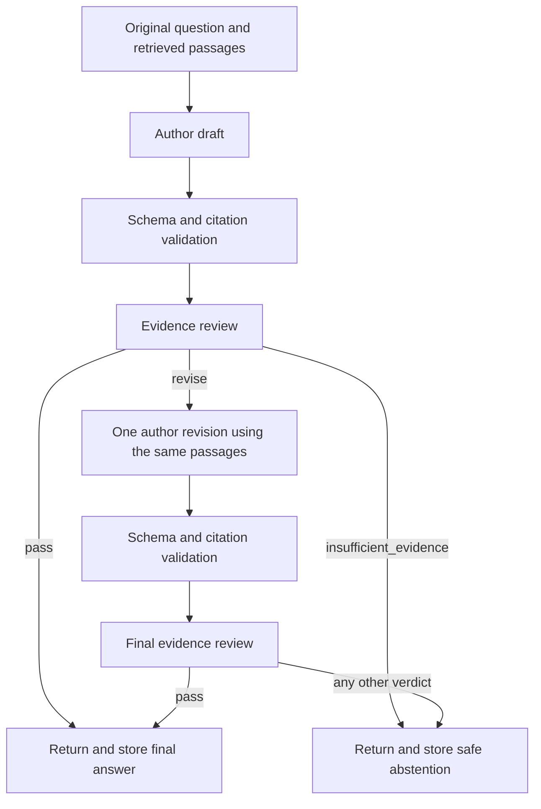

# Evidence reviewer

[Project overview](../README.md) · [Local chat setup](conversations.md)

Run shell commands from the repository root.

`app/generation/reviewer.py` adds a separate evidence-review prompt and one
async `ModelProvider.generate()` call. It uses the existing provider factory
and configuration, including the installed local `qwen3:4b-instruct` model.
The reviewer adds no dependency, model download or public endpoint. `/chat` now
invokes it through the deterministic Python coordinator; findings remain
internal and are never added to `ChatResponse` or conversation history.

## Live chat workflow



The book is searched once. Both reviews receive the original question and the
exact original author evidence snapshot; revision receives those same passages,
the draft and validated findings as untrusted data. No stage retrieves extra
evidence or silently removes/truncates passages. Citations and source metadata
resolve against the original canonical results, for both draft and revision.

Code-invalid drafts or reviews return a safe provider error, without retries.
Empty retrieval, no fitting evidence, clarification and author abstentions stop
early. An author abstention after revision also stops without another review,
using a server-written abstention instead of unreviewed revision prose.
On reviewer rejection the coordinator constructs a static abstention, never
returning the rejected draft or raw findings. Only final answers/abstentions and
the original user message enter history and the duplicate-response cache.
Existing completed request IDs keep replaying their committed response; review
applies to new generations, without re-executing historical requests.

The author/review workflow allows at most **four calls**: draft, review, revision,
final review. Conversation turns permit **five including an optional rewrite**.
All stages share `CHAT_DEADLINE_SECONDS` (default 60); each call also has
`MODEL_TIMEOUT_SECONDS`. Timeout returns 504, not a partial answer. The existing
database capacity lease covers the whole turn, with no open transaction during
model work. Retention expiry also fences review/revision calls and final storage.

For local models, initial evidence packing reserves up to 4,000 input bytes
(at most one third of the full prompt budget) for draft/review overhead. Every
review and revision request is then checked against its actual full serialized
size. Large drafts or findings can still exceed the budget: this returns 503
`provider_configuration_error`, rather than changing the evidence or retrying.

## Review contract

`review_draft(question, draft_answer, author_request, *, provider=None,
settings=None)` accepts the original question, the draft text, and the saved
`GenerationRequest` actually sent to the author. It reads that request's
data-only JSON, verifies the question matches, and forwards every supplied
passage unchanged with its full text, ID, source/edition/section IDs, chapter
number and title, and existing citation marker. It does not re-run retrieval,
use display excerpts, or select a smaller evidence subset. The caller must
retain the original author request; the public `/chat` response is not a
substitute for this snapshot.

The separate reviewer prompt asks for unsupported claims, citations that do
not support their accompanying claims, missing or invented citations,
inexact quotations (including single-quoted text), contradictions, invented
personal memories/author identity, failure to answer the original question,
and book accounts presented as externally verified facts. It explicitly
forbids background knowledge and treats the draft, question and all passage
fields as untrusted data. It requests only concise, actionable findings,
never hidden chain-of-thought or a replacement answer.

`app/generation/review_models.py` defines the strict internal response schema:

```json
{
  "verdict": "revise",
  "issues": [
    {
      "claim": "Mira found a golden spaceship.",
      "category": "unsupported_claim",
      "passage_ids": ["passage-amber"],
      "explanation": "Replace golden spaceship with the amber telescope described in the passage."
    }
  ]
}
```

This example is fictional test data, not book text or a live review result.
Categories are `unsupported_claim`, `citation_support`, `quotation`,
`contradiction`, `invented_memory`, `question_relevance`, and `external_fact`.
Every reported issue is blocking. `pass` requires `issues: []`; both `revise`
and `insufficient_evidence` require at least one finding. The prompt requires
`revise` when the supplied evidence can support a useful corrected answer,
and `insufficient_evidence` otherwise. Determining that distinction is a
model judgment, not a guarantee provided by schema validation.

The schema rejects unknown verdicts/categories/fields, blank findings,
duplicate or non-string passage IDs, and more than eight issues. Claims are
limited to 1000 characters and explanations to 500. Each issue references at
most five distinct IDs, all of which must occur in the actual author snapshot;
the request schema also constrains IDs to that set. An empty ID list is valid
when no passage is relevant. Invented draft citations can be described in the
finding text but cannot appear as valid reviewer references. Extra fields
such as `chain_of_thought` or a replacement `answer` are rejected.

The draft is limited to 8000 characters, allowing for the existing AI
disclosure. The entire reviewer prompt, schema, original question, full draft
and all original passages count toward the configured provider budget.
Review adds input beyond author generation. The coordinator reserves room
before the initial draft and uses the same configured provider, model and
context for every role. It never silently increases model memory allocation.
If the complete review or revision input does not fit, a safe
`ProviderConfigurationError` is raised before any model call. Evidence and
draft text are never silently truncated to make review fit.

For an independent internal review call:

```python
from app.generation.reviewer import review_draft

# Keep question, draft, author_request and author_settings from author generation.
# Same provider/model/settings, using the original saved evidence snapshot.
findings = await review_draft(
    question, draft.answer, author_request, provider=provider, settings=author_settings,
)
# findings stays internal; direct calls do not perform revision or persistence.
```

The reviewer uses the same bounded `MODEL_TIMEOUT_SECONDS`, raw output limit,
Ollama structured-output transport and safe provider errors as the baseline.
Timeout cancels the call; malformed review is an `InvalidModelOutput`, never
an implicit `pass` or abstention. `review_draft` itself performs no retries,
repairs or revisions; the coordinator owns the one permitted revision.
The default author's fake response is not a review verdict and is
rejected; offline reviewer tests supply scripted `FakeProvider` responses.
The implementation adds no prompt, draft, passage or findings logging.

Install and test from the repository root using the existing environment:

```sh
source .venv/bin/activate
python -m pip install -e '.[test]'
python -m pytest tests/test_reviewer.py tests/test_workflow.py
python -m pytest
```

The focused suite verifies parsing, verdict/issue consistency, every category,
unknown/unsupplied passage IDs, exact snapshot preservation, untrusted-data
separation, full-input context rejection, timeout/cancellation, sanitized
failures, two separate author/reviewer calls, and the existing Ollama adapter
with mocked HTTP. All tests are offline. They verify contracts and boundaries,
not semantic reviewer accuracy or prompt-injection resistance. Approval is a
model judgment, not proof that every claim is factually correct. No evaluation
accuracy is claimed. The opt-in `python -m scripts.smoke_ollama` now exercises
the integrated workflow against an installed local model; it does not write
conversation history. See [local chat setup](conversations.md) for `/chat`.

## Observed local verification

A local Qwen `qwen3:4b-instruct` probe for “Who was Sri Yukteswar?” completed
author, review, revision and final review under the default 60-second overall
deadline. The final reviewer did not approve the answer, so the coordinator
returned `insufficient_evidence`. This demonstrates the bounded rejection path,
not a successfully approved answer or factual-accuracy evaluation.

Earlier probes were rejected for oversized review explanations, inconsistent
citations and invalid revision output. Review/revision instructions were made
more explicit about short findings and answer-status rules; application schema
and citation validation remain strict. The small local model can still emit
invalid output, which returns an explicit error without automatic retries.
